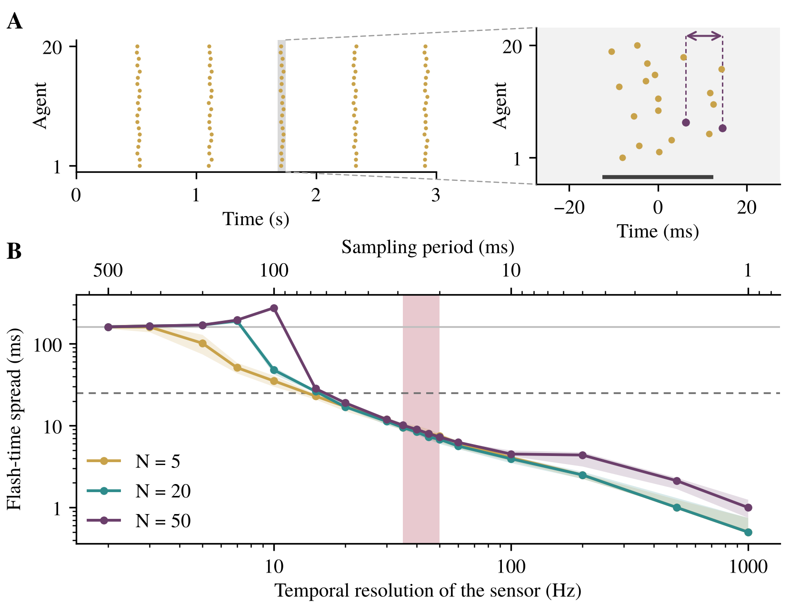

# sensor_firesync

A minimal agent-based model that links one property of a visual sensor, its temporal resolution, to one swarm-level outcome: how tightly a group of flashing agents synchronizes.

The model extends the integrate-and-fire model of single-firefly flash timing in Martin et al. (2026), "Excitation-inhibition interactions mediate firefly flash synchronization", bioRxiv 2026.01.19.700439 (code and data: [peleg-lab/led_firesync](https://github.com/peleg-lab/led_firesync)), to groups of agents whose sensor has a finite temporal resolution.



**Figure.** (A) Flash times of 20 simulated agents whose sensor has the temporal resolution of the firefly eye (40 Hz, sampling period 25 ms). Left: three seconds of one run. Right: the shaded group flash, enlarged; the bar shows one sampling period, and the arrow marks two flashes separated by the flash-time spread (8 ms). (B) Flash-time spread (median and interquartile range of 20 runs) as a function of sensor temporal resolution for groups of 5, 20 and 50 agents. The shaded band marks the flicker fusion frequency of the *Photuris frontalis* eye (35 to 50 Hz, from electroretinography), the dashed line the duration of one flash (25 ms), and the solid gray line the spread expected with no synchrony (one quarter of the flash period).

## Model

- **Agent.** An integrate-and-fire phase oscillator with the natural flash period of *P. frontalis* (0.64 s, 5% variation between agents). The phase rises at a constant rate, the agent flashes when the phase reaches 1, and the phase resets to 0. When the agent perceives a flash, its phase shifts by an amount that depends on its current phase (a phase response curve).
- **Response.** The measured phase response of *P. frontalis*: one fit of the tanh function of Martin et al. to the mean of their response curves across the eight LED periods (amplitude 0.383, offset 1.072, center 0.039, steepness 3.91; RMS error 0.05 in the period ratio). The phase convention is that of Figure 3 of Martin et al.: an agent that flashes ahead of the flash it sees delays its next flash, and an agent that is behind advances it.
- **Sensor.** The eye samples in windows of length 1/f, where f is the temporal resolution in Hz. All neighbor flashes that begin inside one window are perceived as a single event, reported when the window closes. The agent therefore cannot order or count flashes that are closer together than one sampling period.
- **Outcome.** The flash-time spread: the median time between a flash and the nearest flash of each other agent, over the last 20 s of a 60 s run. Zero means perfect zero-lag synchrony. The script also reports the Kuramoto order parameter and the flash period.

## Run

Requires Python 3 with NumPy and Matplotlib.

```
pip install -r requirements.txt
python firefly_swarm_sensor_sweep.py --report            # sweep + the figure above (about 4 minutes)
python firefly_swarm_sensor_sweep.py --report --from-csv sweep_mean.csv   # redraw the figure from the saved sweep
python firefly_swarm_sensor_sweep.py --single 40 --n 20  # one condition, prints the metrics
python firefly_swarm_sensor_sweep.py --k 8               # each agent sees 8 random neighbors
python firefly_swarm_sensor_sweep.py --help              # all options and a full description of the model
```

`--report` writes `sweep_mean.csv` (one row per group size and temporal resolution) and `figure_sensor_resolution.png`. Both files in this repository were produced by that command with the default settings: 20 runs of 60 s per condition, random initial phases, every agent sees every other agent.

## Results

- At the temporal resolution measured for the firefly eye (35 to 50 Hz), every simulated group synchronized, with a flash-time spread of 7 to 10 ms. This is about one third of the duration of a flash and about one third of the sampling period.
- The spread shrinks as the sensor gets faster: about 25 ms at 15 Hz and 4 ms at 100 Hz.
- Synchrony is lost when the sensor is slowed below about 7, 10 and 15 Hz for groups of 5, 20 and 50 agents. Larger groups need a faster sensor.
- With sensors of 200 Hz and faster, synchrony is less reliable for 50 agents (60 to 85% of runs).

## Limits

- The response was measured with a single light source, and the model applies it to mutual interaction among many flashers.
- The phase convention follows Figure 3 of Martin et al. The simulation code in led_firesync uses the opposite sign for this phase; `--phase-sign code` runs the model that way, and the groups then do not synchronize.
- A generic phase-restoring rule (`--prc restoring`) gives a similar spread at 35 to 50 Hz (8 to 10 ms).
- The model does not yet include spatial resolution, sensing range, flash duration and brightness, or movement.

## Funding

This work was supported by Air Force Research Laboratory award FA8651-25-2-0005.
